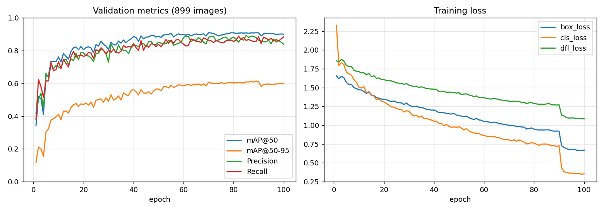

# Real-Time Fall Detection with YOLOv8

A single-class object detector that spots people who have fallen, fast enough for live video monitoring.
IIT Delhi *Advanced AI & Deep Learning Programme* capstone.

| Metric (validation, 899 images) | Value |
|---|---|
| mAP@50 | **0.909** |
| mAP@50-95 | **0.614** |
| Precision | 0.879 |
| Recall | 0.858 |
| Inference | **3.4 ms / image** on a Tesla T4 (~290 FPS model-only) |



*Left: validation metrics per epoch. Right: training losses. The step at epoch 90 is `close_mosaic=10`:
mosaic augmentation is switched off for the last 10 epochs so the model fine-tunes on natural images.*

## What is in this repo

```
notebooks/fall_detection_yolov8.ipynb   end-to-end Colab notebook (audit -> clean -> train -> infer), with training logs
src/data_quality.py                     dataset audit + cleaning CLI (dry run by default)
src/train.py                            training script with the exact hyper-parameters used
src/detect.py                           inference on image / folder / video / webcam with a consecutive-frame alert
results/*.csv                           per-epoch validation metrics and training losses parsed from the run log
assets/training_curves.png              chart generated from those CSVs
```

## Approach

1. **Dataset audit**: counted images, label files and boxes per split
   (train 3,148 / valid 899 / test 450 images, one class `Fall-Detected`).
2. **Data-quality pipeline** (`src/data_quality.py`)
   - unreadable images removed with an OpenCV decode check,
   - exact duplicates removed by MD5 hash,
   - outlier boxes dropped by normalised area (`0.001 <= w*h <= 0.9`), training split only, so the
     validation set is never altered. This removed 29 noisy boxes.
3. **Training** (`src/train.py`): YOLOv8s from COCO-pretrained weights, 640 px, batch 16, 100 epochs,
   AdamW (lr 0.001, cosine schedule, weight decay 5e-4), early-stopping patience 20, fixed seed 42,
   augmentation: mosaic, mixup 0.1, rotation +/-10 deg, translate, scale 0.5, horizontal flip, HSV jitter.
   Checkpoints saved every epoch to Google Drive so a Colab disconnect does not lose progress.
4. **Inference** (`src/detect.py`): streams frames through the model and raises an alert only after a fall
   is seen in *N* consecutive frames, which filters out single-frame false positives in video.

## Quick start

```bash
pip install -r requirements.txt

# 1. get the dataset (YOLOv8 export) from Roboflow Universe -- see "Dataset" below
# 2. audit and clean it
python src/data_quality.py --dataset data/fall-detection            # report only
python src/data_quality.py --dataset data/fall-detection --apply

# 3. train (GPU recommended; ~2 h on a T4)
python src/train.py --data data/fall-detection/data.yaml

# 4. run the trained model
python src/detect.py --weights runs/fall/exp_v8s/weights/best.pt --source my_video.mp4 --save
python src/detect.py --weights runs/fall/exp_v8s/weights/best.pt --source 0     # webcam
```

The trained weights (`best.pt`, 6 MB) are attached to the
[latest release](../../releases/latest). Download them into `weights/` to skip training.

Prefer Colab? Open `notebooks/fall_detection_yolov8.ipynb`, upload the dataset zip and run all cells.

## Results in context

- mAP@50 climbs past 0.85 by epoch ~35 and plateaus around 0.90; the best checkpoint (epoch 89 by
  mAP@50-95) is the one reported above.
- Precision and recall are balanced (0.88 / 0.86). For a safety use case, the confidence threshold can be
  lowered to trade precision for recall; the alert rule in `detect.py` then limits extra false alarms.
- Model-only latency of 3.4 ms leaves headroom for multi-camera use on one GPU; end-to-end FPS depends on
  video decoding and I/O.

## Limitations and next steps

- The dataset mixes scraped photos and video frames; performance on fixed CCTV angles (top-down, low light)
  needs its own validation set.
- Single class: a "lying down intentionally" vs "fallen" distinction would need temporal context
  (pose sequence or a short clip classifier on top of the detector).
- Next: export to ONNX / TensorRT, add pose-keypoint features, evaluate on held-out test split per scene type.

## Dataset

[Fall Detection v1](https://universe.roboflow.com/roboflow-universe-projects/fall-detection-ca3o8/dataset/1)
by Roboflow Universe Projects, licensed **CC BY 4.0**. The dataset is not redistributed here; download it
from Roboflow in *YOLOv8* format.

## License

[AGPL-3.0](LICENSE), matching the [Ultralytics](https://github.com/ultralytics/ultralytics) library this
project builds on.
